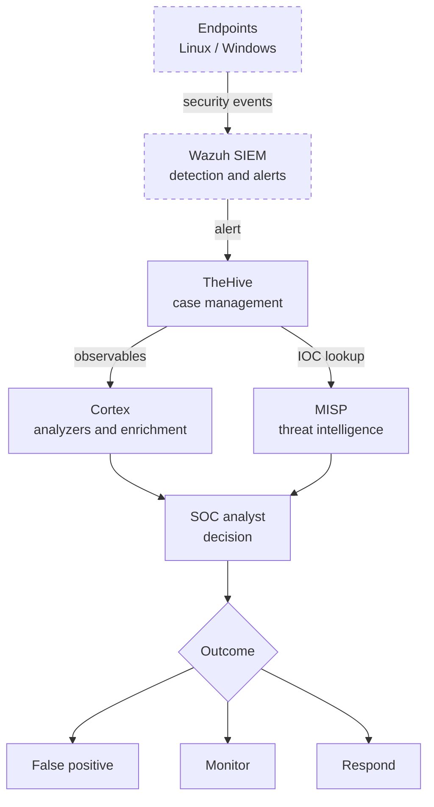

# SOC SOAR Deployment Lab


A Docker Compose lab that deploys **TheHive** (case management), **Cortex** (automated observable analysis) and **MISP** (threat intelligence) together, so a SOC analyst can take an alert from *detection* to *investigation* to *enrichment* in one environment.

> **Scope note:** Wazuh (SIEM) is part of the intended SOC architecture, but it is **not** deployed by this Compose file. This repository covers the SOAR and threat-intelligence layer. See [Roadmap](#roadmap).

---

## Table of contents

- [How it works (in plain words)](#how-it-works-in-plain-words)
- [Architecture](#architecture)
- [Components](#components)
- [Quick start](#quick-start)
- [Service endpoints](#service-endpoints)
- [Example investigation](#example-investigation)
- [Repository structure](#repository-structure)
- [Operations and troubleshooting](#operations-and-troubleshooting)
- [Security notes](#security-notes)
- [Roadmap](#roadmap)
- [Skills demonstrated](#skills-demonstrated)
- [Disclaimer](#disclaimer)
- [Author](#author)

---

## How it works (in plain words)

Think of a hospital emergency room:

| In the hospital | In this lab |
|---|---|
| Alarm goes off at a patient's bed | **Alert** from a SIEM such as Wazuh |
| Patient file is opened | **Case** in TheHive |
| Lab runs blood tests | **Cortex** analyzes IPs, domains, URLs, hashes |
| Doctor checks the known-disease database | **MISP** shows whether an indicator is already known as malicious |
| Doctor decides treatment | **Analyst** decides: false positive, monitor, or respond |

---


https://github.com/user-attachments/assets/8480ed30-e6ac-45e3-8e08-8bf0075d85f9


## Architecture



Dashed boxes are outside this Compose stack (planned integration).

---

## Components

**Deployed by `docker-compose.yml`**

| Service | Image | Role |
|---|---|---|
| `thehive` | `strangebee/thehive:5.2` | Case management and investigation |
| `cortex.local` | `thehiveproject/cortex:latest` | Runs analyzers and responders on observables |
| `misp.local` | `coolacid/misp-docker:core-latest` | Threat-intelligence platform |
| `misp-modules` | `coolacid/misp-docker:modules-latest` | MISP enrichment modules |
| `cassandra` | `cassandra:4` | TheHive database |
| `elasticsearch` | `elasticsearch:7.17.9` | Search index (TheHive, Cortex) |
| `minio` | `quay.io/minio/minio` | S3-compatible object storage for TheHive |
| `misp_mysql` | `mysql/mysql-server:5.7` | MISP database |
| `redis` | `redis:latest` | MISP cache and queue |

All services share one Docker bridge network, `SOC_NET`.

---

## Quick start

### Prerequisites

- Linux host with **Docker Engine** and **Docker Compose v2**
- Git
- Internet access (images and analyzer repository are downloaded)
- **8 GB RAM recommended** for the full stack (TheHive alone is capped at 1.5 GB; Cassandra, MISP and MySQL need more on top)

```bash
docker --version
docker compose version
git --version
```

### 1. Clone

```bash
git clone https://github.com/Pamidipallikiran/soc-soar-deployment.git
cd soc-soar-deployment
```

### 2. Configure secrets

```bash
cp .env.example .env
nano .env
```

Replace every `change-me` value. Generate strong secrets with:

```bash
openssl rand -hex 32
```

`.env` is git-ignored. Never commit it.

### 3. Validate the configuration

```bash
docker compose --env-file .env config > /dev/null && echo "Config OK"
```

### 4. Install the Cortex analyzers

```bash
./scripts/setup-cortex-analyzers.sh
```

This prepares the `Cortex-Analyzers/` folder that the Cortex container mounts. See [`cortex/README.md`](cortex/README.md) for details.

### 5. Start the stack

```bash
docker compose up -d
docker compose ps
```

First start can take several minutes while MISP initializes. Follow progress with `docker compose logs -f misp.local`.

---

## Service endpoints

| Service | URL | Port |
|---|---|---:|
| TheHive | `http://<HOST-IP>:9000` | 9000 |
| Cortex | `http://<HOST-IP>:9001` | 9001 |
| MinIO console | `http://<HOST-IP>:9002` | 9002 |
| MISP | `http://<HOST-IP>` / `https://<HOST-IP>` | 80 / 443 |
| Elasticsearch | `http://<HOST-IP>:9200` | 9200 |
| Cassandra | `<HOST-IP>:9042` | 9042 |

Check the [security notes](#security-notes) before exposing any of these beyond your own machine.

---

## Example investigation

**Scenario:** an employee reports a suspicious email, and the SIEM raises an alert about a connection to an unknown IP.

1. **Case** – The analyst opens a case in TheHive and adds the sender domain, the IP and the attachment hash as *observables*.
2. **Analyze** – From TheHive, the analyst runs Cortex analyzers on each observable (for example an IP reputation check and a file-hash lookup).
3. **Check intelligence** – The same indicators are searched in MISP to see whether they appear in known campaigns.
4. **Decide** – The results are combined with endpoint context:
   - Clean everywhere → close as **false positive**
   - Suspicious but unproven → keep **monitoring**
   - Known malicious → **respond** (block the indicator, isolate the host, escalate)

Which analyzers are available depends on what is installed and configured in your Cortex instance.

---

## Repository structure

```text
soc-soar-deployment/
├── cortex/
│   ├── application.conf        # Cortex configuration
│   └── README.md               # Cortex-specific notes
├── docs/
│   └── SOAR_Deployment_with_MISP.pdf
├── files/                      # MISP supporting data
│   ├── community-metadata/
│   ├── feed-metadata/
│   ├── misp-decaying-models/
│   ├── misp-galaxy/
│   ├── misp-objects/
│   ├── misp-workflow-blueprints/
│   ├── noticelists/
│   └── scripts/
├── scripts/
│   └── setup-cortex-analyzers.sh
├── server-configs/             # MISP configuration (bootstrap, core, routes)
├── docker-compose.yml
├── .env.example                # Template for secrets (copy to .env)
├── .gitignore
├── LICENSE
└── README.md
```

---

## Operations and troubleshooting

| Task | Command |
|---|---|
| Status of all containers | `docker compose ps` |
| Last 100 log lines, all services | `docker compose logs --tail=100` |
| Follow one service | `docker compose logs -f thehive` |
| Restart one service | `docker compose restart cortex.local` |
| Stop the stack (keep data) | `docker compose down` |
| Stop and **delete all data** | `docker compose down -v` |

| Symptom | What to check |
|---|---|
| Container keeps restarting | `docker compose logs --tail=100 <service>`; look for DB connection or memory errors |
| "variable is not set" warnings | `.env` is missing or a value is empty; compare with `.env.example` |
| Cortex shows no analyzers | Re-run `./scripts/setup-cortex-analyzers.sh`, then check `docker compose logs cortex.local` |
| TheHive cannot start | Cassandra and Elasticsearch must be up first; give them a minute, then check logs |
| Elasticsearch exits immediately | Host may need `sudo sysctl -w vm.max_map_count=262144` |

---

## Security notes

This is a **lab**, not a hardened production deployment.

- **Secrets** – Keep real values only in `.env`. Never commit keys, passwords or certificates (the `.gitignore` already blocks `.env`, `*.pem`, `*.key`, `*.crt`, `*.p12`, `*.pfx`, `*.jks`, logs and databases).
- **Published ports** – The Compose file publishes services on `0.0.0.0`. Elasticsearch runs with `xpack.security.enabled=false`, so port 9200 has **no authentication**. Run this on an isolated host or VM, or bind ports to `127.0.0.1` / firewall them.
- **Docker socket** – Cortex mounts `/var/run/docker.sock` so it can start analyzer containers. Anyone who controls that container can control the Docker host.
- **Image tags** – `cortex` and `redis` use `latest`. Pin versions for reproducible builds.
- **Default passwords** – Change every `change-me` value before first start.

Before committing, confirm no secrets are tracked:

```bash
git ls-files | grep -E '(^|/)\.env$|\.(key|pem|p12|pfx|jks)$'   # should print nothing
```

---

## Roadmap

- [ ] Add Wazuh and forward alerts to TheHive
- [ ] Automatic observable extraction and Cortex enrichment on new alerts
- [ ] Two-way MISP integration
- [ ] MITRE ATT&CK mapping on cases
- [ ] Health checks and pinned image versions
- [ ] TLS and reverse proxy
- [ ] Backup and restore scripts
- [ ] CI check that validates `docker compose config`
- [ ] Screenshots of a working case, analyzer report and MISP event in `docs/`

---

## Skills demonstrated

- **SOAR and case management** – TheHive deployment and configuration
- **Observable analysis** – Cortex analyzer setup and Docker-based execution
- **Threat intelligence** – MISP deployment with galaxies, objects, feeds and noticelists
- **Containers** – multi-service Docker Compose, volumes, networks, environment-based configuration
- **Security hygiene** – secret separation with `.env`, `.gitignore` rules, documented risks
- **SOC workflow** – alert, triage, enrichment, decision

---

## Disclaimer

For education, research and **authorized** lab use only. Do not run against systems or networks you do not have permission to test. Harden the deployment (authentication, TLS, network controls, backups) before any production use.

---

## Author

**Kiran Pamidipalli** – aspiring SOC Analyst
GitHub: [@Pamidipallikiran](https://github.com/Pamidipallikiran)

Licensed under the [MIT License](LICENSE).
